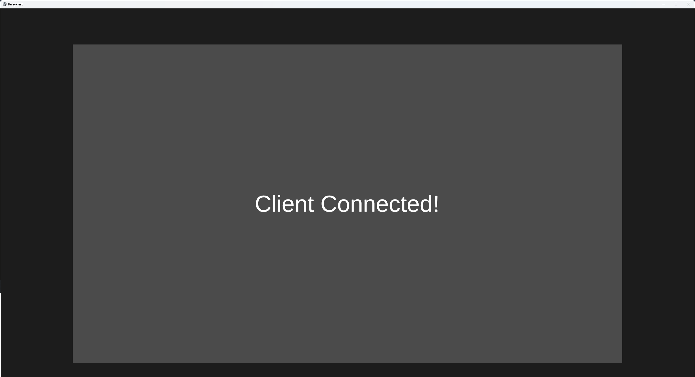

# Unity Relay Example

A basic example of the required networking for using Unity's Relay Service allowing clients to connect to a server without the need for port-fowarding

> [!NOTE]
> You may need to allow the server through any firewalls when prompted (Likely Windows specific) - on other platforms you may neeed to configure networking settings accordingly

## How to use

#### Web Build
Visit [GitHub Pages Hosted Web Build](https://archie-murray.github.io/Unity-Relay-Example) or open your own local build in two different browsers and manually type the code into a client - unfortunately the copy feature does not work on web builds for now.

#### Native Builds:
Run the server and client, and monitor the server console log for a message like this:
```console
[Lobby] Server Join Code: <6 Digit Join Code Here>
```
At this point the server has started and is ready to accept clients, paste this into the 'Enter Code' box and press the 'Start Client' button, if all goes well you should see the following screen:


## Unity Project Setup
For use in own projects, you must link the project via the [Unity Dashboard](https://cloud.unity.com) - the error messages from relay provides a really useful guide for this - note you do not need the project ID to be set to use Relay but it may be required for other paid services like Game Servers, etc.

## Next Steps
This is only an example for the absolute bare minimum, you may want to check connection requests via something like [Network Manager - Connection Approval](https://docs.unity3d.com/Packages/com.unity.netcode.gameobjects@2.4/manual/basics/connection-approval.html) where the payload `byte[]` can be used to store things like password hashes or usernames/ids so the server only needs to respond to valid connection requests, you may also want a 'lobby stage' where all players connect before the game starts.
